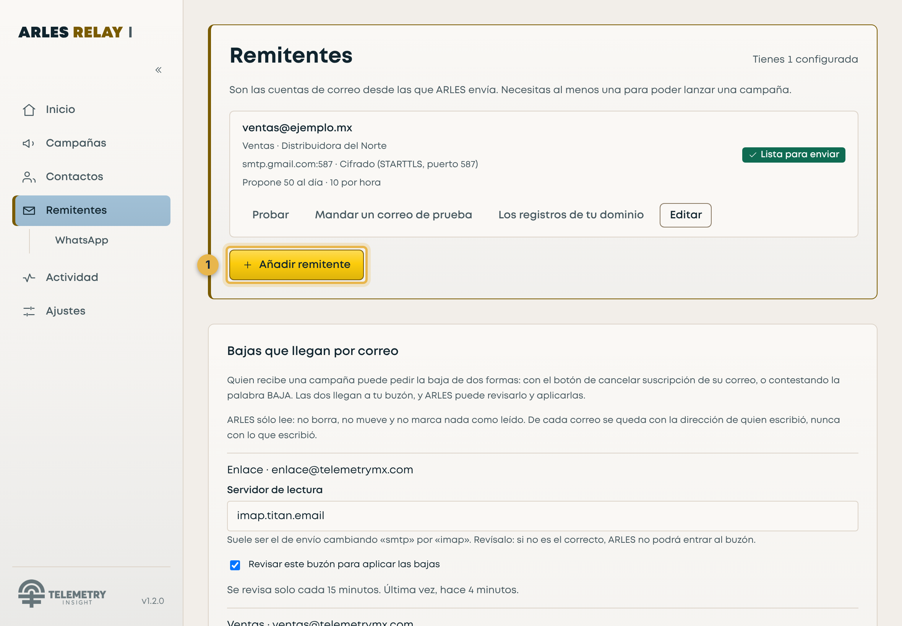
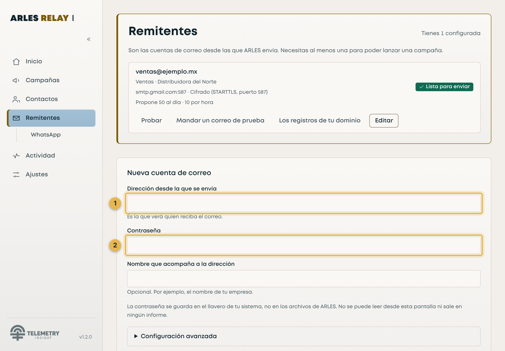
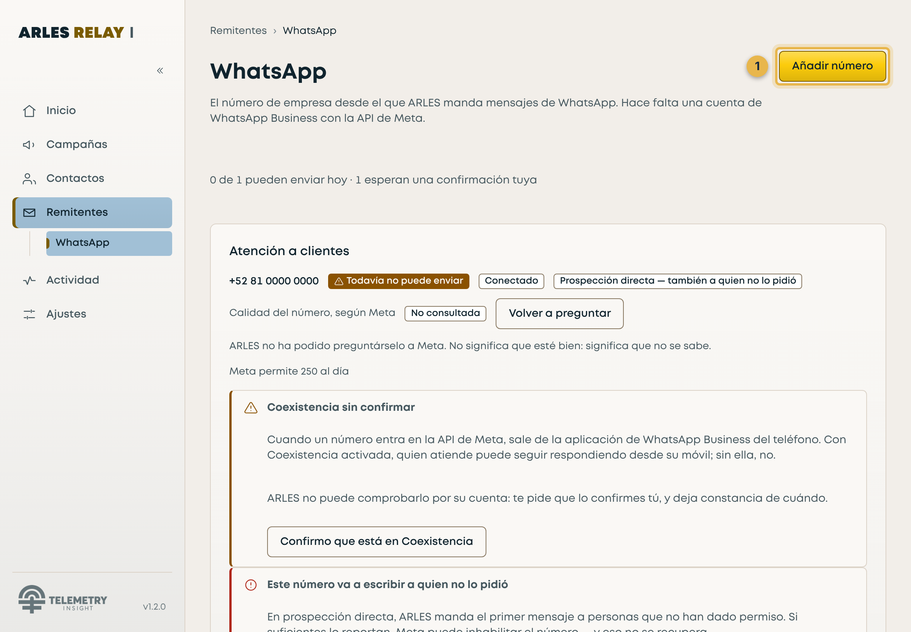
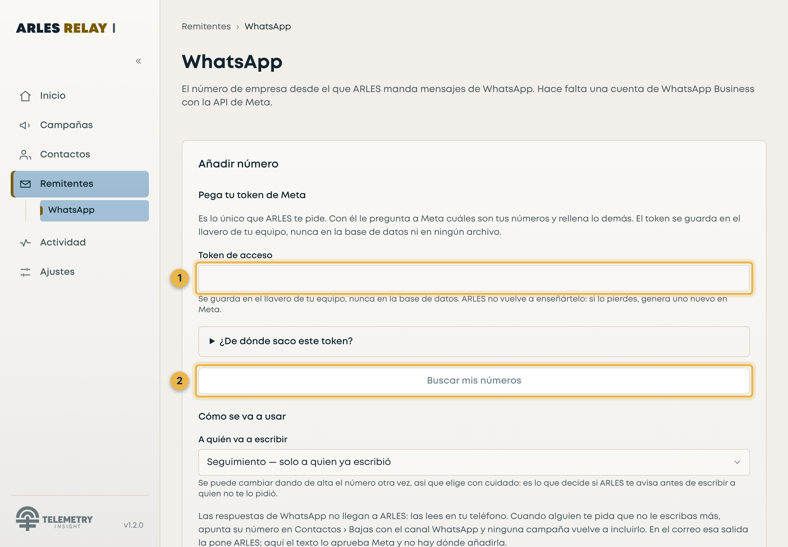

# Dar de alta un correo y un WhatsApp

> Paso a paso, para quien abre ARLES por primera vez

@@ PARA | Quien va a usar ARLES, sin saber nada de él
@@ DE QUÉ VA | Las dos altas que hay que hacer antes de enviar nada
@@ CUÁNTO TARDA | El correo, 10 minutos. El WhatsApp, entre 30 y 90
@@ FECHA | 12 de noviembre de 2026
@@ QUÉ HACE FALTA ANTES | Tener ARLES instalado y abierto

=== 0 · Léete esta página primera

**ARLES no manda nada hasta que le des un remitente.** Un remitente es la
cuenta desde la que salen los mensajes: un correo, un número de WhatsApp, o los
dos. Esta guía es exactamente eso y nada más.

**Las dos altas no se parecen, y conviene saberlo antes de empezar.**

| | El correo | El WhatsApp |
|---|---|---|
| Qué te pide ARLES | Tu dirección y una contraseña | Un token de Meta |
| Cuánto tarda | Diez minutos | De media hora a hora y media |
| De qué depende | De ti | De que Meta apruebe tu cuenta de empresa |
| Se puede hacer hoy | **Sí** | Sólo si ya tienes cuenta de empresa en Meta |

!i **Haz primero el correo.** Es el que funciona en diez minutos y el que te
deja probar ARLES de verdad hoy. El de WhatsApp necesita un trámite con Meta
que no depende de ARLES ni de ti.

**Dónde se hace todo esto:** en ARLES, en la sección **Remitentes** de la barra
de la izquierda. Ahí dentro hay dos pantallas, **Correo** y **WhatsApp**.

!i **Las capturas de esta guía son las pantallas de verdad**, con sus datos de
ejemplo, y los recuadros dorados están puestos sobre el botón o el campo real —
no dibujados encima. En tu equipo la ventana tendrá el marco de Windows
alrededor, y la letra será otra mientras la tipografía de la marca siga
pendiente de licencia.

=== 1 · El correo · paso a paso

### 1-1 · Lo único que necesitas saber antes

**No vale la contraseña con la que entras a tu correo.** Y no es un problema de
ARLES: Gmail, Outlook y los demás **ya no dejan** que otro programa entre con
esa contraseña. Hay que generar una contraseña aparte, que sirve sólo para
ARLES y que puedes borrar cuando quieras.

Eso es el único paso que se hace fuera de ARLES, y está en el 1-3.

!i **Si tu correo es de tu empresa** —algo como `tu.nombre@tuempresa.com`— y no
es de Gmail ni de Outlook, pregúntale a quien lleve el correo de la empresa por
«los datos SMTP». ARLES te va a pedir tres: servidor, puerto y cifrado.

### 1-2 · Abre el formulario

1. En ARLES, pulsa **Remitentes** en la barra de la izquierda.
2. Pulsa el botón **«Añadir remitente»**.
3. Se abre un formulario que se llama **«Nueva cuenta de correo»**.

Tiene dos campos a la vista, y sólo dos:

- **«Dirección desde la que se envía»** — tu correo completo. Es la que verá
  quien reciba el mensaje.
- **«Nombre que acompaña a la dirección»** — opcional. Por ejemplo el nombre de
  tu empresa. Si lo dejas vacío no pasa nada.

!i **En cuanto escribas la dirección, ARLES rellena solo el resto** si reconoce
el dominio. Reconoce estos cinco, con sus datos ya medidos y correctos:

| Si tu correo acaba en | ARLES pone |
|---|---|
| `@gmail.com` · `@googlemail.com` | smtp.gmail.com · puerto 587 |
| `@outlook.com` · `@hotmail.com` · `@live.com` · `@msn.com` | smtp-mail.outlook.com · puerto 587 |
| `@yahoo.com` · `@yahoo.com.mx` · `@yahoo.es` | smtp.mail.yahoo.com · puerto 465 |
| `@zoho.com` · `@zohomail.com` | smtp.zoho.com · puerto 465 |
| `@icloud.com` | smtp.mail.me.com · puerto 587 |

**Si tu dominio no está en esa lista**, ARLES abre solo un apartado que se llama
**«Configuración avanzada»** con cuatro campos —Usuario, Servidor, Puerto y
Cifrado— y ahí van los datos que te dé tu empresa.

### 1-3 · La contraseña, si usas Gmail

Dentro del formulario, ARLES te enseña un apartado titulado **«¿Usas Gmail?
Necesitas una contraseña de aplicación»**. Lo que dice, paso a paso:

1. **Activa la verificación en dos pasos** en tu cuenta de Google. Sin eso, la
   opción de contraseñas de aplicación **no aparece** en ninguna parte.
2. Entra en **`myaccount.google.com/apppasswords`** —ARLES te da un botón para
   copiar esa dirección—, escribe un nombre que te recuerde para qué es
   (`ARLES` sirve) y pulsa **Generar**.
3. Google te da **dieciséis letras en cuatro grupos**. Cópialas y pégalas en el
   campo **«Contraseña»** de ARLES. **Los espacios no importan**: ARLES los
   quita.

!! **Esa contraseña sólo se enseña una vez.** Si cierras la ventana de Google
sin copiarla, hay que generar otra. No pasa nada —puedes crear las que quieras
y borrar las viejas— pero vas a repetir el paso.

!i **Si usas Outlook, Yahoo, Zoho o iCloud** es el mismo concepto con otro
nombre: busca «contraseña de aplicación» en la configuración de seguridad de tu
cuenta. Lo que **no** sirve en ninguno de los cinco es tu contraseña de entrar.

### 1-4 · Probar y guardar

1. Pulsa **«Probar conexión»**. ARLES habla con el servidor de verdad y te dice
   qué pasó.
2. Si sale bien, pulsa **«Guardar cuenta»**.

=> LO QUE TIENES QUE VER :: La cuenta aparece en la lista con el estado **«Lista para enviar»**.

!x **Si falla, el mensaje te dice tres cosas**: qué pasó, cómo arreglarlo y qué
está a salvo. Léelo entero antes de cambiar nada — las tres causas que se
repiten son la contraseña de entrar en vez de la de aplicación, la verificación
en dos pasos sin activar, y un dominio de empresa cuyos datos SMTP son otros.

### 1-5 · La prueba que de verdad cierra el paso

En la ficha de la cuenta, pulsa **«Mandar un correo de prueba»** y pon **tu
propia dirección**.

**Si el correo llega a tu bandeja, el alta está terminada.** Que una cuenta
«conecte» no quiere decir que un correo llegue: son dos cosas distintas, y ésta
es la que importa.

### 1-6 · Mientras estás aquí: la casilla de las bajas

Debajo de la lista hay un apartado llamado **«Bajas que llegan por correo»**.

Si lo enciendes, ARLES mira el buzón de ese remitente **cada quince minutos**
—sólo lectura, nunca borra ni marca nada— y da de baja sola a quien conteste
pidiéndolo o pulse el botón de cancelar suscripción de Gmail o de Outlook.

!i **No hace falta ninguna contraseña nueva**: usa la misma que acabas de
guardar. ARLES propone el servidor de lectura cambiando `smtp.` por `imap.`, y
lo puedes corregir si tu empresa usa otro.

=== 2 · El WhatsApp · paso a paso

### 2-0 · Lo que tienes que saber antes de empezar

!! **Esto no se resuelve en diez minutos y no depende de ARLES.** WhatsApp no
funciona como el correo: para mandar mensajes con un programa hace falta una
**cuenta de empresa en Meta**, y Meta tiene que aprobarla. Si no la tienes, el
alta en ARLES no se puede completar hoy.

**Lo que hace falta, y en este orden:**

| | Qué | Dónde |
|---|---|---|
| 1 | Una cuenta de empresa en Meta (WhatsApp Business Platform) | business.facebook.com |
| 2 | Tu número dado de alta ahí, con **Coexistencia** | El panel de Meta |
| 3 | Al menos una **plantilla aprobada** por Meta | El panel de Meta |
| 4 | Un **token de acceso** | El panel de Meta |

**Sólo el 4 te lo pide ARLES.** Los tres primeros se hacen en el panel de Meta,
y están explicados paso a paso en la guía
`COMO-CONFIGURAR-WHATSAPP.md`, que acompaña a ésta.

!x **Coexistencia es la palabra que hay que buscar.** Es lo que permite que el
mismo número siga funcionando en tu teléfono con la aplicación de WhatsApp
Business **y** a la vez pueda enviar desde ARLES. Sin ella, dar el número de
alta en la plataforma **te lo quita del teléfono**.

### 2-1 · Saca el token en Meta

Hay dos tipos y sirven para cosas distintas:

**Para la primera prueba — el token temporal.** En la pantalla de WhatsApp del
panel de Meta verás «Token de acceso temporal» y un botón de copiar.
**Caduca a las 24 horas.** Para probar hoy es lo más rápido.

**Para trabajar — el token permanente:**

1. En **business.facebook.com**, entra en **«Configuración del negocio»**.
2. **«Usuarios»** → **«Usuarios del sistema»** → **«Agregar»**.
3. Ponle un nombre (`ARLES` sirve) y rol **«Administrador»**.
4. Pulsa **«Asignar activos»**, elige tu **cuenta de WhatsApp** y dale
   **control total**.
5. Pulsa **«Generar nuevo token»**:
   - Elige tu aplicación.
   - Caducidad: **«Nunca»**.
   - Marca **los dos** permisos: `whatsapp_business_messaging` y
     `whatsapp_business_management`.
6. **Copia el token ahora.** Meta no lo vuelve a enseñar.

!! **Los dos permisos hacen falta, y no es lo mismo.** El primero es para
mandar; el segundo es para que ARLES pueda **preguntarle a Meta cuáles son tus
números**, que es lo que te ahorra copiar identificadores a mano. Con sólo el
primero, ARLES te dirá que el token no vale **aunque sirva para enviar**.

!i **ARLES lleva esto escrito dentro.** En el formulario hay un desplegable
llamado **«¿De dónde saco este token?»** con estos mismos pasos, así que no
hace falta tener esta guía abierta.

### 2-2 · El alta en ARLES

1. En ARLES, entra en **Remitentes** y luego en **WhatsApp**.
2. Pulsa **«Añadir número»**.

3. En el apartado **«Pega tu token de Meta»**, pega el token.
4. Pulsa **«Buscar mis números»**.

**ARLES le pregunta a Meta y te enseña tus números**, cada uno con su nombre, su
calidad según Meta y cuántos mensajes al día te deja mandar. Eso es el apartado
**«Elige el número con el que vas a escribir»**: marca el tuyo.

!i **No tienes que copiar ningún identificador.** Es lo que hacen los dos
permisos del paso anterior: ARLES los pregunta. Hasta el 05/11/2026 había que
pegarlos a mano, y ahí es donde se perdía la gente.

### 2-3 · Cómo se va a usar, y las dos confirmaciones

Debajo aparece **«Cómo se va a usar»**, con dos opciones. **No es una
preferencia: cambia a quién puede escribir ese número.**

- **«Seguimiento — solo a quien ya escribió»**. Sin riesgo. Es lo que
  recomienda el proyecto.
- **«Prospección directa — también a quien no lo pidió»**. Es legítimo, y es lo
  que más calidad cuesta: Meta mira cuánta gente te bloquea o te reporta.

Según lo que elijas, ARLES te pide confirmar una o dos cosas, con un botón cada
una:

| Confirmación | Cuándo aparece |
|---|---|
| **«Confirmo que está en Coexistencia»** | Siempre |
| **«Entiendo el riesgo y lo acepto»** | Sólo con prospección directa |

!x **Hasta que las confirmes, el número no envía nada.** No es un aviso que se
pueda saltar: ARLES comprueba las dos antes de cada envío, y la ficha dirá
**«Todavía no puede enviar»**.

Cuando estén, pulsa **«Guardar número»**.

=> LO QUE TIENES QUE VER :: El número aparece en la lista como **«Puede enviar»**, con su calidad y el tope que Meta le da al día.

### 2-4 · La prueba

En la ficha del número, pulsa **«Mandar un WhatsApp de prueba»**, pon **tu
propio número con código de país** y elige una plantilla aprobada.

**Si el mensaje llega a tu teléfono, el alta está terminada.**

!! **Si usas el número de prueba que da Meta**, antes tienes que apuntar tu
número en su lista de destinatarios permitidos, en la misma pantalla del panel
donde copiaste el token. Si no, Meta rechaza el envío y ARLES te dirá que ese
número no existe — porque es lo que Meta contesta, aunque exista.

=== 3 · Lo que ARLES guarda, y dónde

Esto no es un detalle técnico: es la respuesta a «¿dónde queda mi contraseña?».

| Qué | Dónde queda |
|---|---|
| La contraseña del correo | En el **Administrador de credenciales de Windows**, no en ARLES |
| El token de Meta | En el mismo sitio |
| Todo lo demás | En una base de datos **cifrada**, en tu equipo |

!i **Ninguna pantalla de ARLES vuelve a enseñar una contraseña ni un token**, y
no es que estén escondidos: es que ARLES no los puede leer de vuelta para
mostrarlos. Si alguien se lleva tu base de datos, no se lleva tus credenciales.

!x **La primera vez que abras ARLES, Windows te va a pedir permiso para guardar
una credencial.** Es correcto y hay que aceptarlo: ahí va la llave con la que
ARLES cifra su base de datos. **Si el Administrador de credenciales no
responde, ARLES no arranca** — nunca guarda esa llave en un archivo.

=== 4 · Si algo no sale

| Lo que ves | Qué es |
|---|---|
| «La cuenta no autentica» al probar el correo | Casi siempre es la contraseña de entrar en vez de la de aplicación. Vuelve al 1-3 |
| En Gmail no aparece «Contraseñas de aplicación» | Falta activar la verificación en dos pasos. Es el paso 1 del 1-3 |
| «Meta no acepta ese token» | Comprueba que el usuario del sistema tenga **los dos** permisos y la cuenta de WhatsApp asignada con control total |
| «Meta acepta tu token» pero no sale ningún número | El token vale; lo que falta es que tu cuenta de WhatsApp esté asignada a ese usuario del sistema |
| El número dice «Todavía no puede enviar» | Faltan las confirmaciones del 2-3 |
| El correo de prueba no llega | Mira la carpeta de no deseados. Que el servidor lo acepte y que llegue a la bandeja son dos cosas distintas |

**Y lo que más vale la pena saber:** cada error de ARLES dice **tres** cosas —
qué pasó, cómo se arregla y **qué está a salvo**. Esa tercera parte existe para
que sepas que no has perdido nada antes de tocar más botones.

=== 5 · Lo que esta guía no cubre

- **Crear la cuenta de empresa en Meta y la plantilla.** Son los pasos 1 a 3 del
  2-0, y están en `COMO-CONFIGURAR-WHATSAPP.md`.
- **Lo que viene después del alta**: cargar contactos, escribir una plantilla y
  crear la campaña. Eso es el `MANUAL-DE-USUARIO.md`.
- **Dar de alta un correo que no sea SMTP.** ARLES se conecta por SMTP con
  contraseña de aplicación. No hay botón de «entrar con Google» ni con
  Microsoft.
